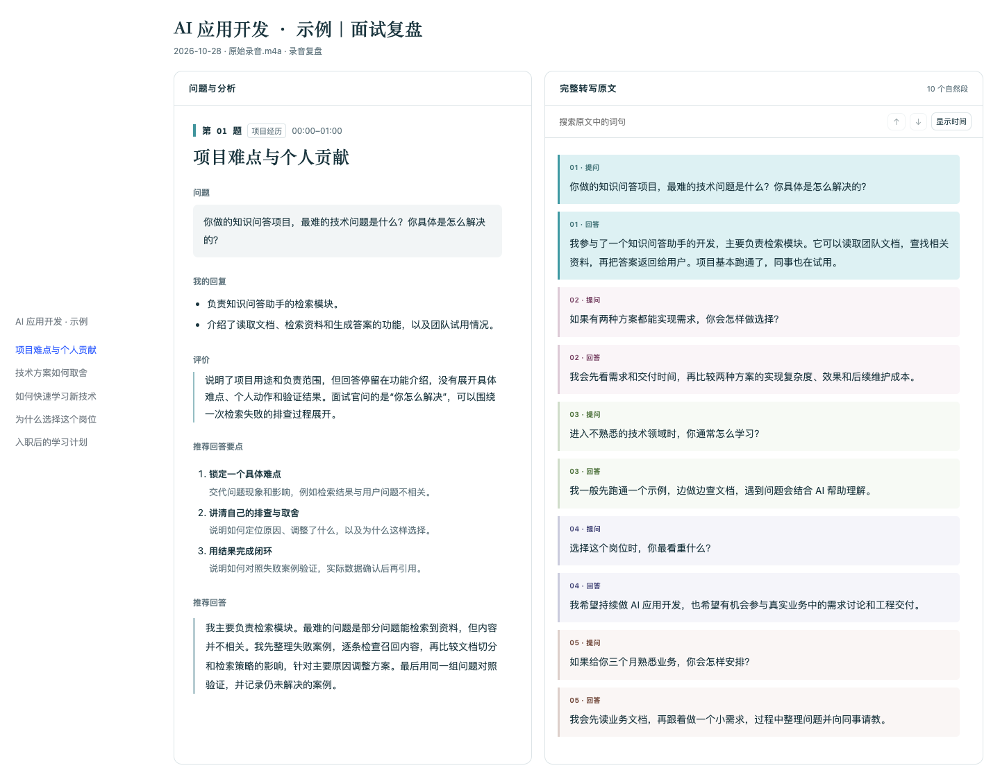

# 面试录音复盘

**把面试录音变成逐题复盘报告：看清哪里没答好，下次可以怎样回答。**

面试结束后，把录音交给 Codex。这个 Skill 会整理面试官的问题和你的实际回答，指出回答中的亮点与缺口，再给出推荐回答要点和一段可以练习的表达。你可以随时对照原文，回看当时究竟说了什么。

## 看看报告长什么样



*截图使用虚构的面试问答，仅展示报告效果。*

## 它能帮你做什么

- **整理一场面试问了什么。** 自动提取实质问题，同一主题的追问放在一起，方便回顾。
- **发现回答中的具体缺口。** 例如只讲了项目功能，却没有讲清技术难点和自己的贡献；有结果，却缺少统计口径。
- **为下一次面试练习表达。** 每题给出推荐回答要点和连贯话术，帮助你补充真实经历、重新组织回答。
- **把分析和原话对照着看。** 点击题目定位相关原文，点击高亮原文查看对应分析；也可以搜索词句。

报告清楚区分“我的回复”和“推荐回答”。不确定的内容会标注待核，需要你补充的经历也会明确提示。

## 开始使用

需要 **Codex、Apple Silicon Mac 和 Python 3.10+**。

首次安装：

```bash
git clone https://github.com/theRealBurgerKing/interview-audio-review-skill.git \
  "${CODEX_HOME:-$HOME/.codex}/skills/interview-audio-review"
cd "${CODEX_HOME:-$HOME/.codex}/skills/interview-audio-review"
bash scripts/setup.sh
```

然后在 Codex 中提供录音路径：

```text
使用 $interview-audio-review 复盘 ~/Downloads/面试录音.m4a，
重点看看项目经历有没有讲清楚，并给出更好的回答方式。
```

也可以指定面试名称、分析重点或保存位置。未指定名称时，使用源录音文件名。首次安装和下载转写模型需要联网，后续可复用缓存。

## 拿到报告之后

用浏览器打开 HTML：先看整体评价，再从左侧目录进入想复盘的问题。每题都包含“问题”“我的回复”“评价”“推荐回答要点”和“推荐回答”，推荐内容直接展开。完整原文始终保留在右侧。

报告可离线阅读，手机上也能查看。默认保存到 `~/Documents/面试录音分析/YYYY-MM-DD-面试名称/`，同目录保留转写稿和录音副本。副本命名为“原始录音”并保留原扩展名，源文件保持不变。

## 常见问题

**支持什么格式？**

支持 m4a、mp3、wav、mp4、flac 等常见音视频文件。

**转写和分析在哪里完成？需要付费吗？**

音频转写在本机完成，无语音 API 费用；转写后的问答分析由 Codex 完成，费用和数据处理方式取决于你使用的 Codex 环境。

**已有转写稿，还需要重新转写吗？**

可以要求复用带时间信息的转写稿。仅调整报告样式时，也可以直接重新生成 HTML。

**会复盘所有内容吗？**

默认分析面试官的实质问题，略去现场代码实现题和候选人反问，这些原文仍会保留。你可以指定其他分析范围。

**可以直接背推荐回答吗？**

建议先补齐提示中缺少的真实信息，再按自己的经历练习表达。自动转写和评价可能存在误差，重要内容请结合录音核对。

环境配置和转写参数见[转写说明](references/transcription.md)；完整工作流程与配置见 [SKILL.md](SKILL.md)。
